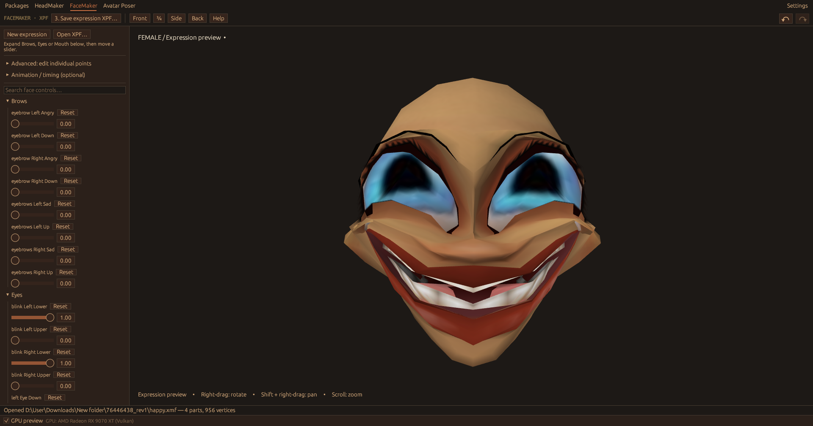

  

  
Windows · Linux · macOS

  

    <a href="https://github.com/ilovealienz/IMVUWU/releases/latest"><strong>Download IMVUWU</strong></a> ·
    <a href="#creator-tools">Creator tools</a> ·
    <a href="#build-from-source">Build from source</a>
  

  
   
  <em>FaceMaker’s expression editor and 3D preview.</em>

## Creator tools

| Tool | What you can do |
| --- | --- |
| **Packages** | Look up products by ID or shop link. Browse files and revisions, preview images and 3D meshes, and download CHKN, ZIP or images with restored filenames. Export meshes to OBJ or use **Make blend** to create a Blender file with Blender installed. |
| **HeadMaker** | Edit XMF heads with morph controls, symmetry and neck repair. |
| **FaceMaker** | Create and export XPF facial expressions. |
| **Avatar Poser** | Pose one or two avatars and export XAF. |

IMVUWU is a fan-made project independent of IMVU. It uses public product data and requires no IMVU account or login.

## Download

Choose your platform on the [Releases page](https://github.com/ilovealienz/IMVUWU/releases).

| Platform | Download | Launch |
| --- | --- | --- |
| **Windows 10/11** (x86-64) | `IMVUWU-<version>-windows-x86_64.exe` | Open the executable. Windows SmartScreen may flag the unsigned build. |
| **Linux** (x86-64, glibc 2.28+) | `IMVUWU-<version>-linux-x86_64.tar.gz` | Extract the archive and run `./IMVUWU`. |
| **macOS** (Apple Silicon) | `IMVUWU-<version>-macos-arm64.tar.gz` | Extract the archive and open `IMVUWU`. macOS may ask you to approve the unsigned build in **System Settings › Privacy & Security**. |

### First launch

IMVUWU downloads the base female avatar (product **80**, with its default skin) and male avatar (product **191**) from IMVU's public servers. It stores the avatars and settings in the following folders.

| Platform | Data folder |
| --- | --- |
| Windows | `%APPDATA%\IMVUWU` |
| Linux | `~/.local/share/IMVUWU` |
| macOS | `~/Library/Application Support/IMVUWU` |

The 3D previews use **wgpu** with DirectX 12, Vulkan, Metal or OpenGL. Windows also supports software rendering and an OpenGL fallback. Linux uses your desktop's graphics stack (OpenGL or Vulkan), Wayland or X11, and file picker service. NixOS users can build with the included flake.

## Build from source

Install [Rust](https://rustup.rs/), then run the command for your platform from the repository root.

| Platform | Build | Test or develop |
| --- | --- | --- |
| Windows | `.\build.ps1` | `.\build.ps1 -Test` runs tests and Clippy. Add `-NoLinux` to skip the Linux cross-build. |
| Linux / macOS | `./build.sh` | `./build.sh test` |
| NixOS | `nix build`, then `./result/bin/imvuwu` | `nix develop` opens a development shell. |

The Windows script uses Rust's `gnullvm` toolchain and a checksum-verified llvm-mingw download. It cross-builds for Linux with Zig. Visual Studio is optional.

[GitHub Actions](.github/workflows/build.yml) builds and tests Windows, Linux and macOS and runs rendering checks for each platform. Pushing a `v*` tag publishes the three release downloads.

The public builds fetch base avatars at runtime. The optional `bundled-imvu-avatars` build and tests that require local IMVU head meshes use developer-supplied assets.

## Diagnostics

| Command | What it does |
| --- | --- |
| `--software-gpu` | Runs with a software graphics adapter. |
| `--wgpu-render-check <folder> [--software]` | Renders diagnostic scenes to a folder without opening a window. |
| `--renderer wgpu\|glow\|glow-basic` | Selects the renderer. |
| `--imvu-check <report>` | Checks live IMVU product lookups and writes a report. |

If startup fails, look for `startup-log.txt` in the data folder listed above.

## Licence

IMVUWU's code is distributed under the [MIT Licence](LICENSE). IMVU and its content belong to their respective owners.
